# NutriLens

A private, on-device health app for iPhone, iPad and Apple Watch, built with SwiftUI around Apple
Health. It brings together **food logging** with an Indian and Maharashtrian food table, a guided
**12-week home strength plan**, **sleep**, **smart-scale body composition** and a **calorie balance**
that adjusts for workouts and steps.

No account, no server, no analytics and no network requests. Your data stays on your devices and
syncs only through your own iCloud.

| Today | Train | Strength session | Sleep | Body |
|---|---|---|---|---|
| 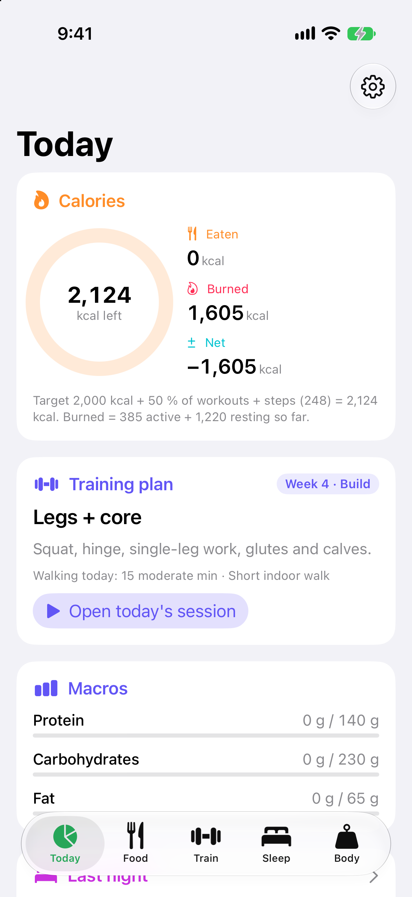 | 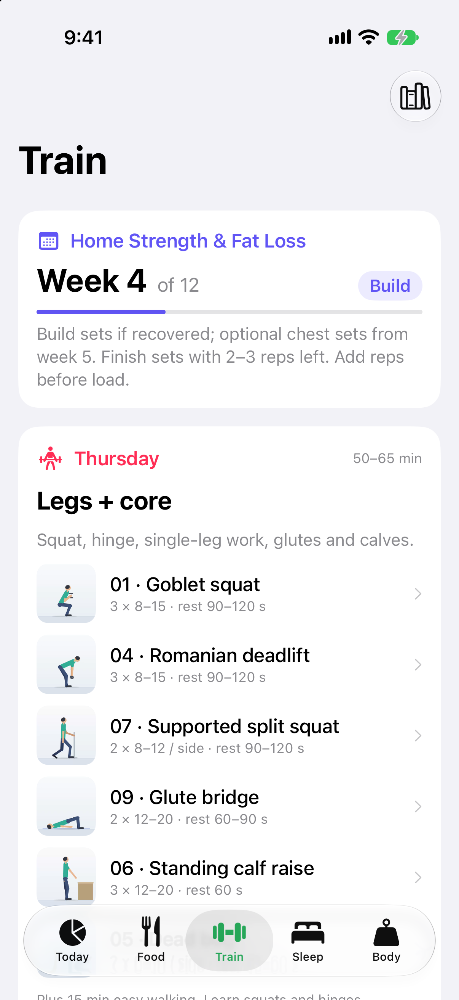 | 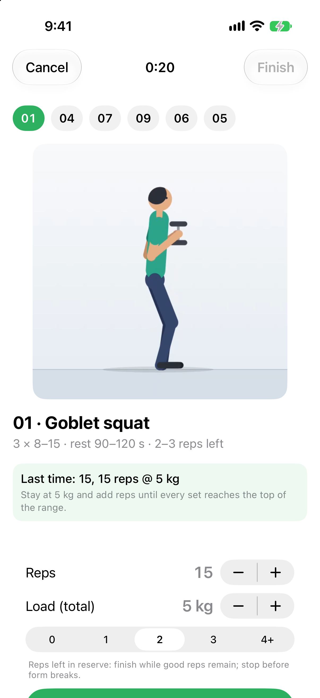 | 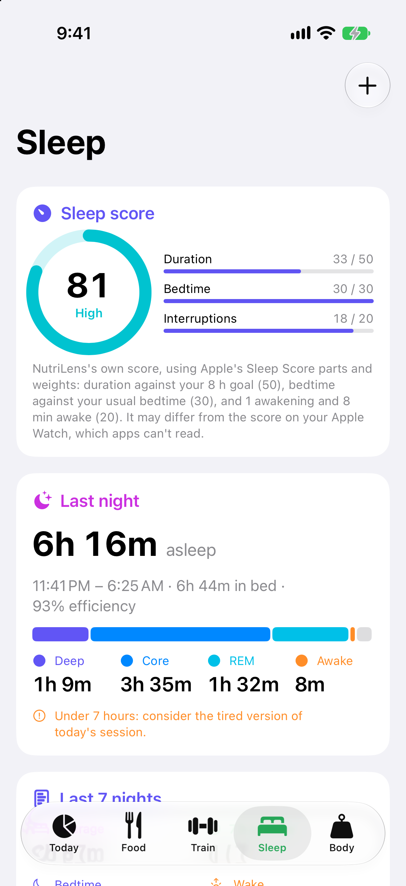 | 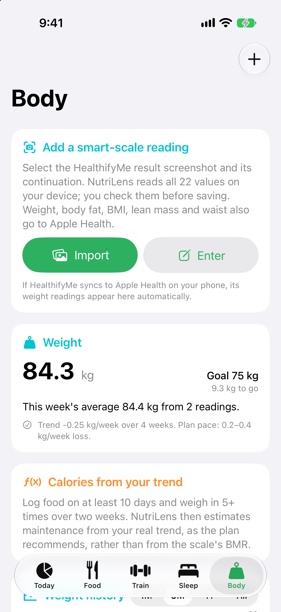 |

| Log food | Search | Recipes | Macros by item | Calendar |
|---|---|---|---|---|
| 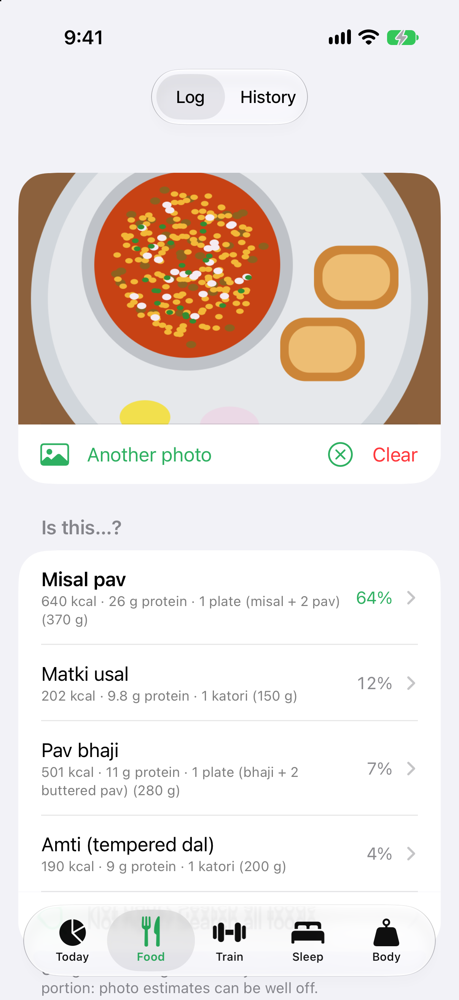 | 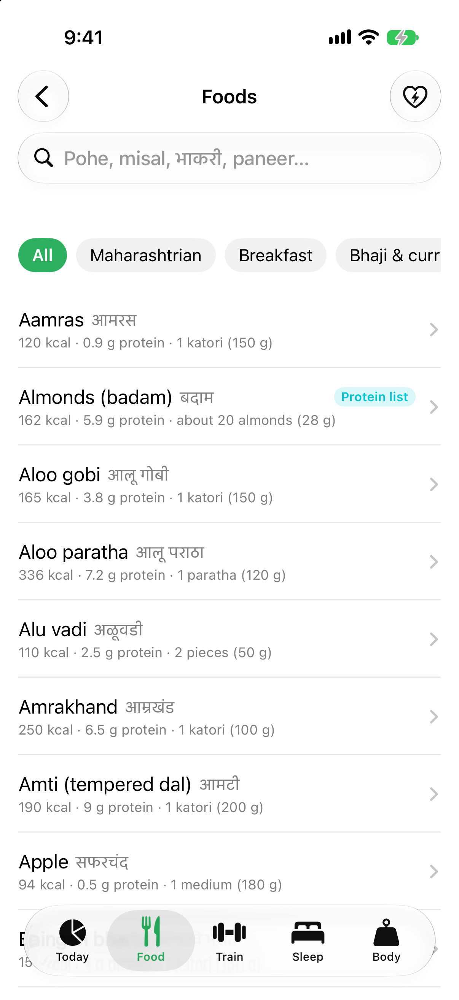 | 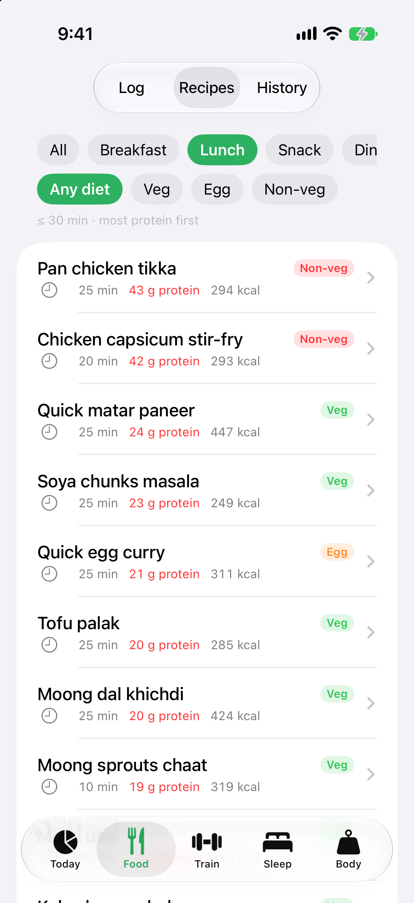 | 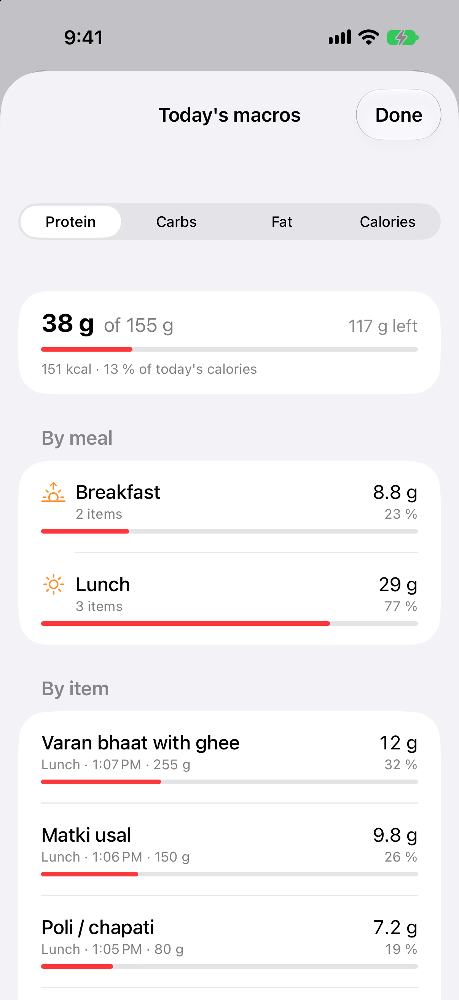 | 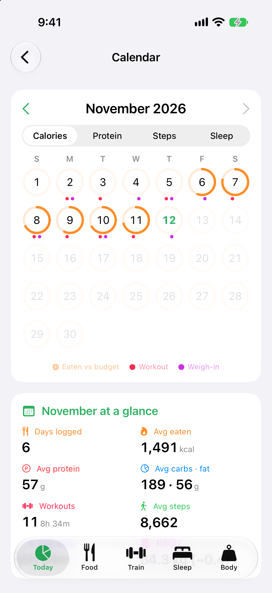 |

| Watch: today | Watch: strength | Watch: rest | Watch: finish |
|---|---|---|---|
| 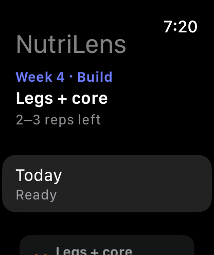 | 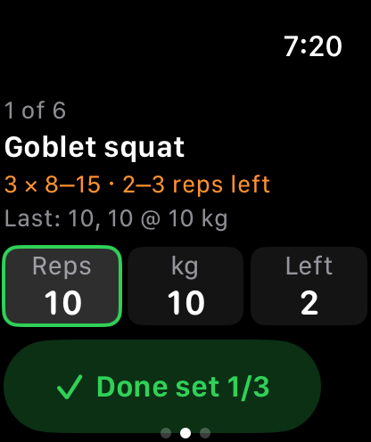 | 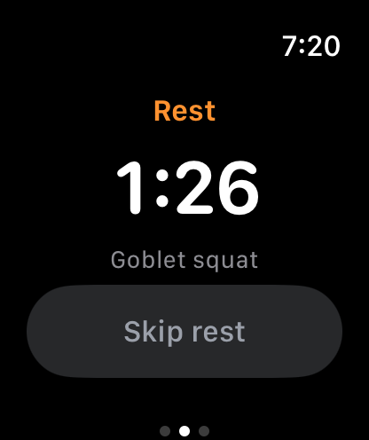 | 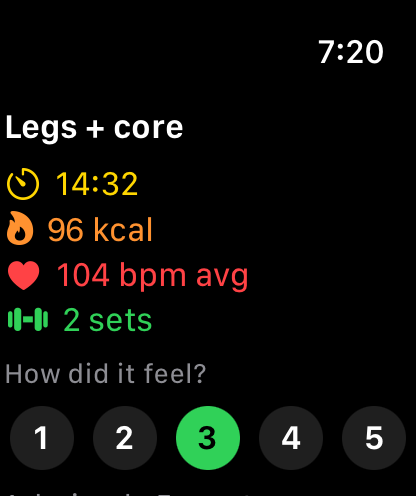 |

*Simulator screenshots in demo mode with invented sample data. More in [`docs/screenshots`](docs/screenshots).*

## Features

**Today**
- Calories eaten, burned and left, with macro targets that follow the day's plan session and your
  usual steps (more carbs on training days, protein by body weight).
- Tap the macros for a breakdown by meal and by item. Meals are grouped into breakfast, lunch,
  snack and dinner; tap any meal to edit or delete it.
- A calendar with one record per day: calories, macros, workouts, steps, sleep and weight.

**Food**
- About 230 foods, Indian and Maharashtrian first (pohe, misal, bhakri, varan bhaat…), plus produce,
  protein sources and common international foods. Search with filters and a most-protein-first sort.
- Dishes made your way: set the eggs, paneer, soya chunks or oil, or add protein to any dish.
- Describe a new dish in one sentence ("chicken keema with 250 g raw chicken, 2 eggs, 2 tsp oil") and
  NutriLens adds up its ingredients.
- 16 quick protein-rich recipes (30 minutes or less) with ingredients, steps and one-tap logging.
- Your own foods, with CSV import and export. Liquids can be logged in ml.
- Photo suggestions from Apple's on-device Vision classifier; you always confirm the dish and portion.

**Training**
- A 4-day home strength split with a 12-week progression (Learn, Build, Ease off…), a readiness check
  that suggests a lighter session after a short night, and guided sessions with looping exercise
  animations, last time's sets, rest timers and the progression rule.
- Indoor walks, walk/jog intervals and a gentle yoga sequence. Steps and cardio minutes toward weekly
  targets.
- A session recorded by an Apple Watch and also logged in NutriLens counts once, using the Watch's
  measured energy.

**Apple Watch**
- Run the plan's strength, walk, interval and yoga sessions from the wrist as a real workout (heart
  rate, active energy, Activity rings). Sets are pre-filled from last time; adjust them with the
  Digital Crown. Each session is saved to Apple Health once and reaches the iPhone with its sets.

**Sleep**
- A 0–100 sleep score per night (duration, bedtime regularity, interruptions), stages, naps, and
  7/14/30-night trends. This is NutriLens's own calculation, not Apple's score.

**Body**
- Import smart-scale result screenshots: on-device text recognition reads all 22 values (weight, body
  fat, muscle, visceral fat, BMR, metabolic age…) for you to check before saving.
- Weight history with a weekly average and trend, reference ranges for each value (Asian-Indian BMI
  cut-offs by default), and a maintenance estimate from your intake and weight trend.

## Sync between iPhone and iPad

- **Apple Health (free Apple ID):** NutriLens tags what it writes to Health (meals, workouts, scale
  readings) with its record ID and extra fields, and rebuilds them on the other device from Health's
  own end-to-end encrypted iCloud sync.
- **Automatic backup to an iCloud Drive folder:** carries what Health can't (photos, your foods,
  settings), and doubles as a backup you can restore after reinstalling.
- **iCloud (CloudKit, paid developer account):** set `ENABLE_CLOUDKIT_SYNC = YES` to sync everything
  through SwiftData's private CloudKit database, with settings in iCloud key-value storage.

## Requirements

- Xcode 16 or later (Swift 6 language mode).
- iOS / iPadOS 18 or later. Optional: Apple Watch with watchOS 11 or later.

## Getting started

1. Clone the repo and open `NutriLens.xcodeproj`.
2. Choose the **NutriLens** scheme and an iPhone Simulator, then **Run**. No signing is needed for the
   Simulator.
3. Run the tests with **Product › Test**, or:

   ```bash
   xcodebuild -project NutriLens.xcodeproj -scheme NutriLens \
     -destination 'platform=iOS Simulator,name=iPhone 17' test
   swift test --package-path Packages/NutriCore
   ```

**Demo mode** starts with invented sample data in memory: add `-demoMode YES` under Edit Scheme ›
Run › Arguments (extras: `-initialTab today|food|train|sleep|body`, `-demoDayOffset 1`). The Watch app
takes `-demoScreen home|strength|rest|walk|intervals|yoga|finish`.

### Running on your own devices

A free Apple ID is enough.

1. Add your Apple ID in Xcode › Settings › Accounts.
2. Create `Config/Signing.local.xcconfig` (git-ignored):

   ```
   DEVELOPMENT_TEAM = ABCDE12345   // your team ID
   BUNDLE_ID_PREFIX = com.yourname // must be unique
   ```

3. Connect the iPhone, turn on Developer Mode, choose it as the destination and **Run**. Trust the
   developer under Settings › General › VPN & Device Management.
4. **Apple Watch:** turn on Developer Mode on the Watch and wait until it appears under the iPhone in
   Xcode › Window › Devices and Simulators, then run again. The Watch app installs with the iPhone app.

With a free team, apps expire after 7 days (run again to re-sign; your data is kept) and iCloud/CloudKit
isn't available, so sync goes through Apple Health. HealthKit works with a free team.

## Project layout

```
NutriLens/            iOS / iPadOS app (SwiftUI, SwiftData, HealthKit)
NutriLensWatch/       watchOS app (HKWorkoutSession, WatchConnectivity)
NutriLensTests/       app tests (Swift Testing, mock Health service)
Packages/NutriCore/   shared pure-Swift logic and data: nutrition, food table, plan engine,
                      calorie balance, sleep score, scale parser, sync payloads
tools/                exercise animation renderer, food table generator
Config/               xcconfig and entitlements
```

## How the numbers are calculated

- **Portion:** `nutrients = per100g × grams / 100`.
- **Burned** = active + resting energy from Apple Health, never less than workouts + walking.
- **Exercise credit** = a share (default 50 %) of workouts, workouts + walking, or all active energy.
- **Left** = target + exercise credit − eaten.
- **Walking from steps** = steps outside workouts × step length (km) × body mass × 0.5 kcal.
- **Session estimate** = (MET − 1) × body mass × hours (strength 3.5, walking 3.5, jogging in place 7,
  yoga 2.5). A Watch recording replaces the estimate.
- **Maintenance** = average intake − weekly weight change ÷ 7 × 7,700 kcal/kg, over 4 weeks.
- **Weight trend** = least-squares slope over 4 weeks, in kg/week.

Food values are typical per-100 g figures and recipes vary, so treat them as estimates. Photo
recognition can't see portion size or hidden oil.

## Privacy

- Meal photos and scale screenshots are processed on the device; only a small meal thumbnail is kept.
- NutriLens writes to Apple Health only what you log.
- No analytics, no account, no network code. Sync uses your own iCloud or a backup file you move
  yourself.

## Disclaimer

NutriLens is a personal project, not a medical device and not medical advice. Smart-scale body
composition is an estimate. Stop exercising for sharp, joint or radiating pain, and seek urgent care for
chest pressure, fainting or severe breathlessness. Ask a doctor or registered dietitian about calorie
targets.
