# NutriLens

A personal health app for iPhone and iPad (SwiftUI, iOS 18+) built around Apple Health:
**food** (photo recognition on the device), **training** (your 12-week Home Strength & Fat Loss
plan, with looping exercise demos), **sleep**, **body composition** (smart-scale
screenshots, all 22 values) and a **calorie balance** that adjusts for your workouts.

Everything stays on your devices. No account, no cloud food API, no network requests. Sync between
your iPhone and iPad goes through Apple Health's own iCloud sync (free Apple ID) or, once you have
a paid developer account, CloudKit.

| Today | Train | Strength session | Sleep | Body |
|---|---|---|---|---|
|  |  |  |  |  |

| Food log | Food search | Protein sort | Food history | Scale import |
|---|---|---|---|---|
|  |  | 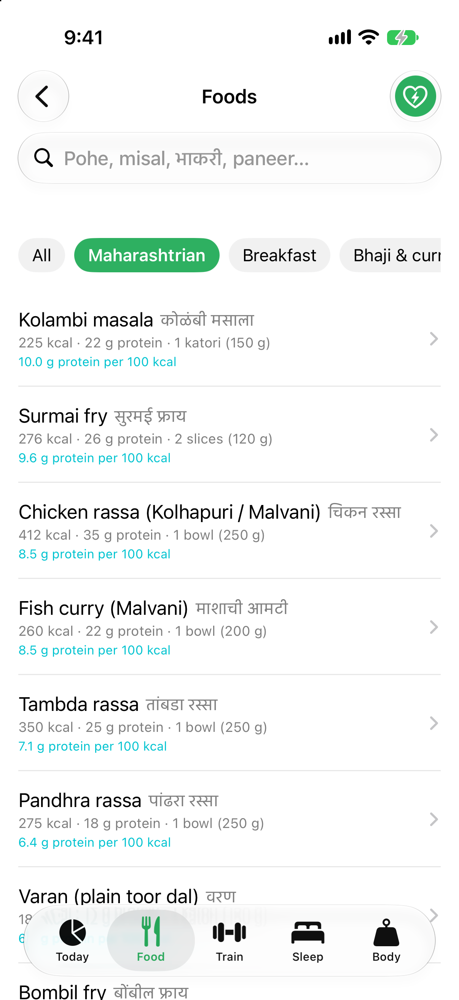 | 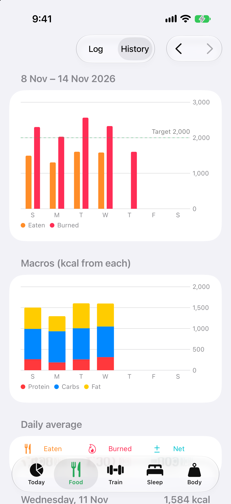 | 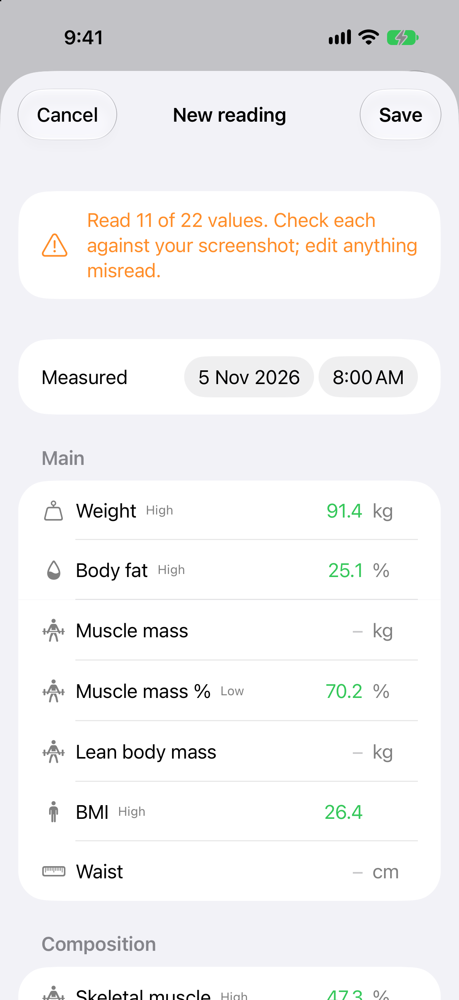 |

| Calendar | One day | Body metric info | Dish your way |
|---|---|---|---|
|  | 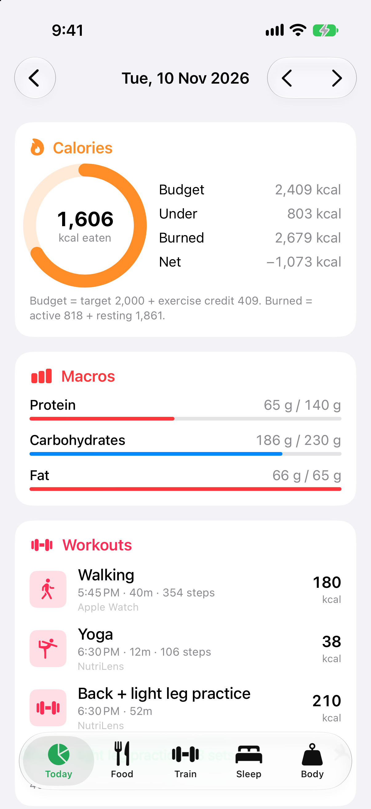 | 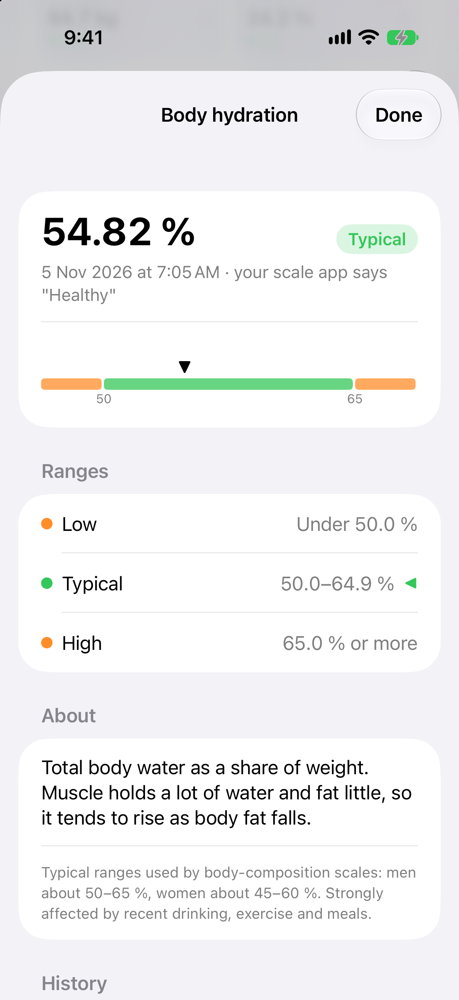 | 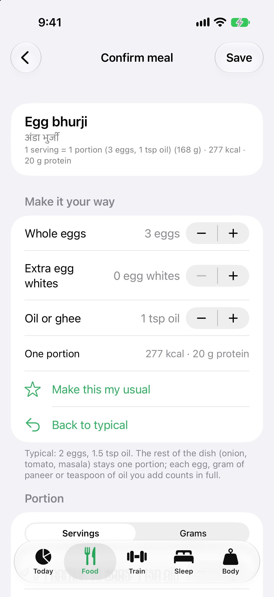 |

| Soya pulao (veg pulao + protein) | Macros set by the day | Daily coffee (milk in ml) |
|---|---|---|
| 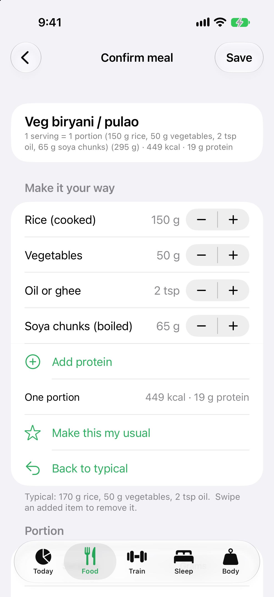 | 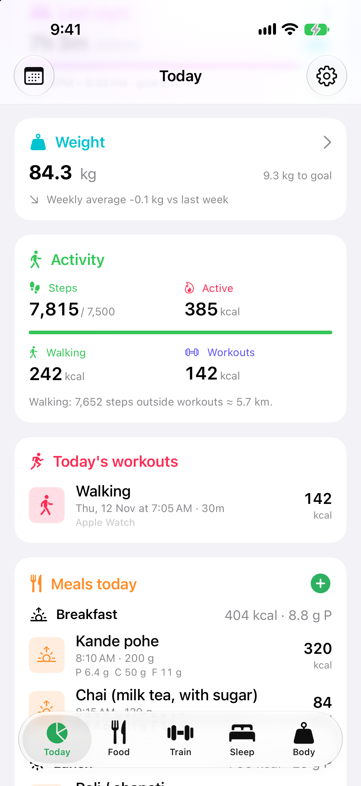 | 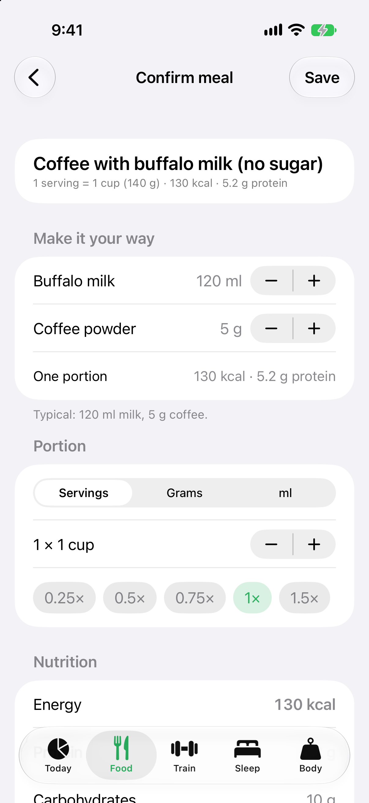 |

**iPad** (sidebar or tab bar, cards in two columns):

| Today | Train | Sleep | Body |
|---|---|---|---|
| 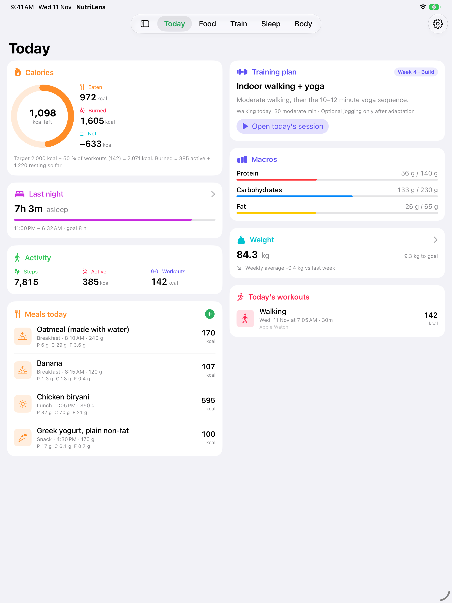 | 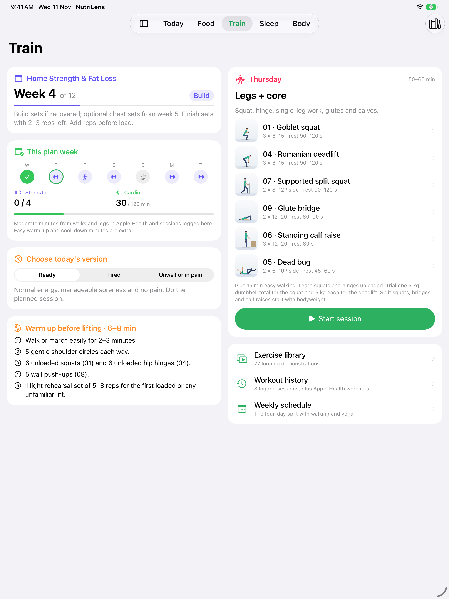 | 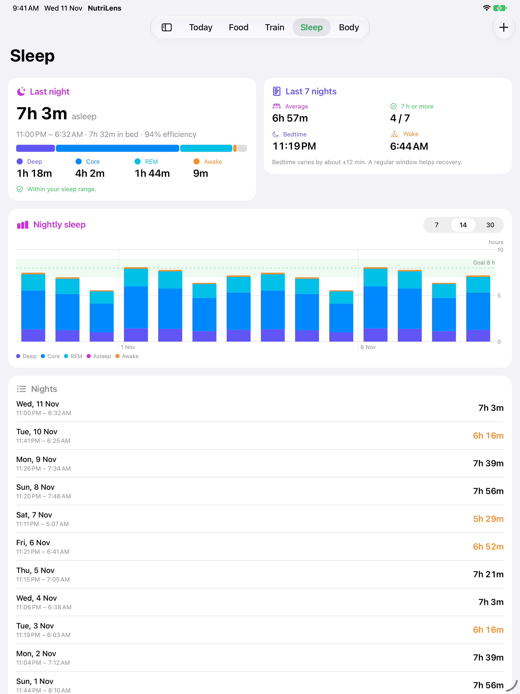 | 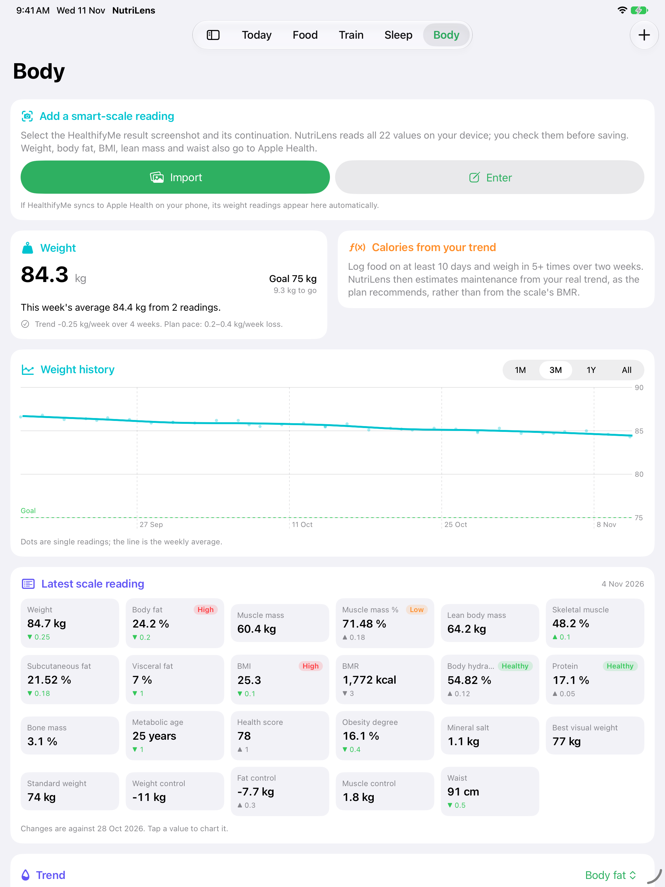 |

*(Simulator screenshots in demo mode. All demo numbers are invented, not your data. The scale
import shows a drawn test image. Demo mode shows "tomorrow", a strength day, on the Train tab.)*

## Features

### Today
Calories eaten vs. burned, net balance, calories left, macros against **the day's targets** (below),
today's plan session, last night's sleep, weight trend, steps,
active energy, today's workouts and meals. Pull down to sync from your other device.

**Macro targets set by the day, not by hand.** Each day's protein, carbohydrate and fat targets come
from that day's plan session and your usual steps (median of the last 14 days in Apple Health, 10,000
when there's no history). Energy is your calorie target plus the exercise credit (Settings, default half
of workouts + steps) for the *planned* session (strength ≈ 45 min plus its easy walk; walk + yoga days the
week's walking minutes plus 12 min yoga) and those steps. Protein follows the plan's 130–160 g: 2.0 g/kg on
strength days, 1.8 on walk + yoga days, 1.7 on rest days. Fat is 25 % (strength), 27 % (walk + yoga) or
30 % (rest) of energy, at least 0.6 g/kg. Carbohydrates are the rest, so they rise on training days
(the plan's "grains or potatoes for training fuel"). Weight comes from Health, else your last scale
reading. At 84.6 kg, 2,000 kcal and 10,000 steps (week 4): Thursday strength 160 g protein, 260 g carbs,
62 g fat; Sunday rest 145 g, 233 g, 72 g. Settings › Macro targets shows today's numbers; the calendar and
day pages use each day's own targets.

**Macros by item.** Tap the Macros card (or one of its bars) for today's breakdown: switch between
protein, carbs, fat and calories to see the total against your target, what share of the day's
calories it makes up, how it splits across breakfast, lunch, snack and dinner, and every item
consumed with its amount and percentage, biggest contributor first.

**Meals today** are grouped under Breakfast, Lunch, Snack and Dinner (in that order), each with its
calories and protein. Empty meals are left out.

**Edit or delete a logged meal.** Tap any meal (Today, the calendar's day view, or Food › History)
to change its name, meal, time, amount (nutrition scales with it; quick 0.5×–2× buttons) or the
nutrition itself, or to delete it. Changes replace the meal's Apple Health entry, so they reach your
iPad too. In History you can also swipe right to edit, left to delete.

### Calendar: every day recorded
Tap the **calendar** button at the top left of Today. Each day of the month shows a ring (switch
between **calories** eaten vs. that day's budget, **protein**, **steps** and **sleep**), a pink dot
for a workout and a purple dot for a weigh-in. Swipe or use the arrows to go back through older
months; *This month* jumps back. Below the grid, the month at a glance: days logged, average
calories, protein, carbs and fat, number and length of workouts, average steps and sleep, and the
weight change.

Tap any day for the full record: calories (budget, under/over, burned, net, and how the budget was
worked out), macros against your targets, every workout (time, length, steps, calories, source,
and the sets of strength sessions logged here), steps and walking energy, active and resting
energy, the night's sleep and sleep score, the day's weight, and every meal grouped by breakfast,
lunch, snack and dinner. The arrows at the top step to the previous or next day.

**How days are stored.** NutriLens saves one record per day on the device (`DayRecord` in
SwiftData). The last 7 days are refreshed each time the app opens or comes back to the foreground,
and a month is refreshed when you open it. Your own logs (meals, sessions) always update the
record. Values from Apple Health (steps, energy, Health workouts, sleep, weight) only replace what
is stored when Health returns something for that day, so a past day keeps its numbers even if the
Health data later goes away. Months before you installed NutriLens fill in from Apple Health the
first time you open them (food only exists from when you started logging here). The calendar is
inside NutriLens; nothing is written to the Calendar app.

### Calories adjusted for workouts and steps
Settings › **Add back exercise**: *Don't add exercise*, *Workouts only*, *Workouts + steps* (default)
or *All active energy*, at 25–100 % (default 50 %, since trackers tend to overestimate).

- **Workout energy** comes from Apple Health workouts (Apple Watch, Fitness, sessions logged in
  NutriLens) plus any NutriLens session not yet in Health.
- **Walking energy from steps**: Health's steps for the day, minus steps taken during workouts (so
  nothing counts twice), × your step length (default 0.75 m, the plan's planning value; calibrate
  in Settings) ≈ distance, at about 0.5 kcal per kg per km.
- **Burned** uses Health's active energy, but never less than workouts + walking. On iPhone-only
  days (no Apple Watch) that's what fills the gap; with a Watch, active energy already includes the
  walking.
- The Body tab estimates **maintenance from your real trend** (intake vs. weekly weight change), as
  the plan recommends instead of the scale's BMR, and suggests the plan's 250–350 kcal deficit.
  Days with under 1,000 kcal logged are treated as partly logged and left out.

### Steps
Today shows steps against your daily goal and the walking energy they add. The Train tab's
**Daily steps** card follows the plan: your recent average, then about 500 more a day (shown as
"Plan's next step", one tap to use), within the optional 6,000–9,000 range. During indoor walks and
walk/jog intervals the iPhone counts steps live (Motion & Fitness permission) and shows distance;
the session stores its steps and distance, and walking energy uses the higher of the time-based and
step-based estimates. Without live counting (Simulator, permission off), Apple Health's steps for the
session are used.

### Training plan (from Workout-Plan.pdf, enhanced)
- **The 4-day split**: Monday chest + shoulders + core, Tuesday back + light legs, Wednesday and
  Friday walking + yoga, Thursday legs + core, Saturday arms + practice, Sunday rest. All 20
  technique-library exercises have their steps, "watch for" and "adjust" notes.
- **12-week progression engine**: week 1 *Learn* (1 set each), week 2 *Intro* sets, weeks 3–5
  *Build*, week 6 *Ease off* (3 sets become 2, 2 become 1), weeks 7–8 *Rebuild*, 9–11 *Continue*, 12
  *Review*. Optional incline push-ups appear only from week 5 and never in deload weeks.
  Reps-in-reserve targets follow the phase. The plan start date is in Settings (default 21 Oct 2026).
- **Readiness check**: Ready, Tired or Unwell, from the plan's weekly check-in. The tired version
  caps sets at 2 and drops optional work, and is **suggested automatically after under 6 h of sleep**.
- **Guided strength session**: looping demo video, this week's prescription and rest, last time's
  sets and the plan's **progression rule** ("top of the range on every set for two sessions → add
  the smallest load"). Main-lift history is kept apart from practice sets on other days, as the
  plan asks. Also: set logging with load and reps left, a rest timer with haptics, a finish sheet
  with an energy estimate and a 1–5 energy rating. Saved to Health as a workout.
- **Cardio**: indoor walk timer toward the week's minutes target (80 → 120–150 → 150 min/week by
  phase). **Walk/jog intervals** stages 1–4 (from week 3, Fridays, 20-minute sessions) with phase
  cues and haptics.
- **Gentle yoga**: the plan's 5-pose sequence with timers and before/after energy.
- **Weekly progress**: strength days done of 4, cardio minutes (Health workouts plus local
  sessions, never double-counted), a 7-day strip and the full weekly schedule.
- **Watch + NutriLens = one session**: start a Watch workout and log the same session here, and it
  counts once. Two recordings that overlap for at least half of the shorter one are the same
  session; the Watch's measured energy and steps are used, and Workout history shows the Watch
  recording with the logged sets.
- **Exercise library**: 27 looping videos (20 strength, 5 yoga, walking and jogging in place).

#### About the exercise videos
They're **original animations made for NutriLens** by `tools/ExerciseAnimator` (an animated
figure rendered to H.264 MP4, 600 × 600, about 3 MB for all 27) and bundled in the app, so they
play offline, silently and on a loop. The PDF's demos are third-party web pages (FitnessProgramer,
Fitwill, MuscleWiki), which can't be embedded or redistributed. The animations follow your plan's
adaptations where they differ from those demos: both feet on the floor for rows and kickbacks, a
supported split squat, a low incline, a flat-floor calf raise and supported hands in the low lunge.
The side plank animation shows the straight-leg version; the plan starts on bent knees, which the
text says. Regenerate them with `scripts/render_exercise_videos.sh`.

### Apple Watch app

Run the session on your wrist instead of in Apple's Workout app, so each session is **one recording**.

- **Today on the wrist**: plan week and phase, today's day, and Ready/Tired (the iPhone's sleep-based
  suggestion; Tired caps sets at 2 and drops optional work). Other strength days can be started too.
- **Strength**: one exercise at a time with this week's prescription and last time's sets. Reps, load
  and reps left are pre-filled from last time; tap a value and turn the **Digital Crown** to change it.
  **Done set** logs it in one tap and starts the rest timer (a tap 10 s before the end, another when
  rest is over). Swipe right for End/Pause, left for time, heart rate and kcal.
- **Walk, walk/jog intervals and yoga**: the walk timer toward the plan's minutes, interval cues with a
  tap at every change, and the 5 yoga poses with hold timers. Exercise videos stay on the iPhone.
- **Measured, not estimated**: an `HKWorkoutSession` with live heart rate and active energy
  (traditional strength, walking, running for walk/jog, yoga). It counts for the Activity rings.
- **Finish**: summary and the 1–5 energy rating, then **Save**. The Watch saves the workout to Apple
  Health with the same NutriLens record ID and payload the iPhone writes, then sends the log to the
  iPhone (instantly when NutriLens is open there, otherwise queued until it is). The iPhone stores it
  with its sets and **never saves a second workout**. If Health's copy arrives first, the log is
  rebuilt from it; either way there's one log, matched by ID.
- **From the iPhone**: plan start, step length, readiness suggestion and your last two sessions of each
  exercise, sent whenever NutriLens refreshes or a session is saved.

 
 

Simulator screenshots: launch the Watch app with `-demoScreen home|strength|rest|walk|intervals|yoga|finish`
(sample data, no HealthKit).

### Sleep (Apple Health)
- **Sleep score (0–100)** for each night, with its three parts. It uses the parts and weights Apple
  uses for its Apple Watch Sleep Score: **duration 50**, **bedtime 30**, **interruptions 20**.
  Apple's own score isn't available to apps (HealthKit in iOS 27.2 has no sleep-score type), and
  Apple doesn't publish its formula, so this is NutriLens's own calculation and may differ:
  - *Duration*: nothing below 3 h, full points at your sleep goal (default 8 h).
  - *Bedtime*: full points within 30 min of your usual bedtime (average of up to 14 earlier
    nights), none at 2 h or more off. Until there are 3 earlier nights, 9 pm–12:30 am counts as on
    time.
  - *Interruptions*: 20 points, minus 3 per awakening after the first and 0.25 per minute awake.
  - Ratings: 90+ Very high, 75–89 High, 60–74 OK, 40–59 Low, under 40 Very low.
- Last night: time asleep, in bed and efficiency. With Apple Watch: deep, core, REM and awake
  stages. Naps are shown separately and don't count toward the night or its score. Gaps between
  recorded sleep count as awake time.
- 7/14/30-night stage charts against the plan's 7–9 h, a 7-night average, nights with 7 h or more,
  average bed and wake times, and how regular your bedtime is. You can add a night by hand (saved to
  Health). Overlapping sources (iPhone and Watch) are merged so nothing counts twice. The score also
  appears on Today and next to each night.

### Body: smart-scale screenshots
Scale readings come in only as screenshots (the scale app doesn't sync to Apple Health). In Body ›
**Import**, select the result screen and its continuation (up to 4 images). Apple's on-device text
recognition reads them; NutriLens maps labels to values, units and status tags ("High",
"Healthy"…), merges the screenshots and shows everything for checking before saving. **Enter**
adds a reading by hand. Checked against your real screenshots: all **22 of 22 values**, every
status tag and the date came out right.

The 22 values are: weight, body fat, muscle mass (kg and %), lean body mass, skeletal muscle,
subcutaneous and visceral fat, BMI, BMR, body hydration, protein, bone mass, metabolic age, health
score, obesity degree, mineral salt, best visual and standard weight, and weight/fat/muscle
control. Waist (tape measure) can be added too. Weight, body fat, BMI, lean mass and waist are
written to Apple Health. The rest stay in NutriLens and travel to your iPad with them (see sync).

The Body tab shows weight history (single readings plus the **weekly average** line, as your plan
asks: "compare weekly averages, not single days"), the trend in kg/week against the plan's
0.2–0.4 kg/week pace, the latest reading as 22 tiles with change since the previous reading, and
a chart for any metric. Readings can be edited and deleted.

**Tap any of the 22 tiles** for what that value means, the low / healthy / high ranges for you, where
your reading sits on a coloured scale, your scale app's own label, and the value's history. Tiles
show a coloured dot (green healthy, orange low or high, red very high) where a recognised range exists:

| Value | Ranges used |
|---|---|
| Weight | Healthy weight for your height from the BMI cut-offs below |
| BMI | **Asian-Indian** (default): under 18.0 low, 18.0–22.9 healthy, 23–24.9 overweight, 25+ obese. **WHO** (switch in Settings › Profile): 18.5 / 25 / 30 |
| Body fat | By sex and age (Gallagher et al., 2000), e.g. men 20–39: 8–19.9 % healthy, 20–24.9 % high, 25 %+ very high; women 20–39: 21–32.9 %, 33–38.9 %, 39 %+ |
| Waist | South Asian (IDF): men under 90 cm, women under 80 cm. WHO: men 94 / 102, women 80 / 88. Also the half-your-height guide |
| Body hydration | Typical 50–65 % (men), 45–60 % (women) |
| Visceral fat | Scale rating 1–12 healthy, 13+ high |
| Obesity degree | Within ±10 % normal, +10 to +20 % overweight, over +20 % obese |
| Metabolic age | At or below your age |
| BMR | No range; shows a Mifflin–St Jeor estimate for comparison |
| Muscle, lean mass, skeletal muscle, subcutaneous fat, protein, bone, mineral salt, health score, standard / best visual weight, weight / fat / muscle control | No agreed medical range: the sheet explains the value and shows your scale app's own rating |

Ranges need your sex, age and height. NutriLens reads them from Apple Health, or you can set them
in **Settings › Profile** (these override Health). These are general reference ranges, not
medical advice.

### Food: Indian and Maharashtrian first

**Raw vegetables and fruit** (filter *Fruit & veg*): English cucumber, tomato, carrot, beetroot,
onion (all raw), mushrooms, banana, plum, white dragon fruit, chikoo, orange, mandarin (Nagpur santra /
kinnow), jackfruit and mango, with common aliases (kakdi, gajar, phanas, kinnow,
pitaya…). Values are typical per 100 g raw (USDA-style). A photo of a cucumber, tomato, carrot, beet,
onion, plum or mandarin suggests the raw food; Apple's on-device classifier has no label for dragon
fruit, jackfruit or chikoo, so search for those. The other basics (oil, ghee, rice, salads…) are under
*Basics*.

**Recipes** (Food › Recipes): 16 quick, protein-rich recipes for one, each ready in 30 minutes
or less: egg bhurji on toast, besan chilla with paneer, peanut butter banana oats, egg-white veggie
omelette, hung curd seed bowl, moong sprouts chaat, soya chunks masala, tofu palak, chicken
capsicum stir-fry, kala chana salad, quick matar paneer, moong dal khichdi, quick egg curry, matki
usal, masoor dal tadka and pan chicken tikka (15–43 g protein each). Filter by breakfast, lunch,
snack or dinner and by veg, egg or non-veg; the list opens on the current meal, most protein first.
Each shows the time, ingredients with weights, steps and anything to do ahead (sprouting, boiling
chana). Nutrition is the sum of the weighed ingredients from the food table, and **Log this meal**
logs one serving.

**Seeds & nuts mix**, one tap away under *Every day* on Log Food (and in search as *seed mix*, *nut
mix*, *mixed nuts*): per meal 5 g each of pumpkin, sunflower and watermelon seeds, almonds and cashews,
4 g walnuts and 1 g pista, 30 g in all: about 173 kcal, 6.7 g protein, 5.8 g carbs and 15 g fat. The
values are the exact sum of those seven foods. Each ingredient has its own stepper (1 g steps), and
**Make this my usual** keeps your amounts for every lunch and dinner. **Watermelon seeds (magaj)**, shelled
and dried, are in the list on their own too.

**Dishes made your way.** Egg bhurji, masala omelette, egg curry, paneer bhurji, tofu bhurji, palak
paneer, kadai paneer, paneer butter masala, soya chunk curry, chicken curry, chicken rassa, egg half fry
(sunny side up) and egg full fry have a *Make it your way* section when you log them: set the whole eggs
(and extra egg whites for the egg dishes), grams of paneer, tofu, boiled soya chunks or chicken (cooked),
and teaspoons of oil or ghee. Veg pulao / biryani, veg fried rice and jeera rice also let you set the
cooked rice, vegetables and oil.

**Add protein to any cooked dish.** Rice dishes, subjis, curries, dals and breakfasts get **Add protein**:
boiled soya chunks, paneer, tofu, eggs, cooked chicken or green peas, in grams (or eggs). A soya pulao is
veg pulao with 150 g rice and 65 g boiled soya chunks: 449 kcal, 19 g protein, logged as
*Veg biryani / pulao (150 g rice, 50 g vegetables, 2 tsp oil, 65 g soya chunks)*.

**Your daily coffee.** *Coffee* (no sugar, Chitale buffalo milk) is first under Food › Log › *Every day*:
5 g coffee powder dissolved in a spoon of water, topped with Chitale buffalo milk. Set the milk for each
cup (10 ml steps; the coffee powder too if it changes). The typical cup (120 ml milk) is 130 kcal and
5.2 g protein; *Make this my usual* keeps your usual amount. The powder uses instant coffee values
(USDA: 353 kcal, 12.2 g protein per 100 g, about 18 kcal per 5 g).

**Millilitres for liquids.** Drinks, milk, buttermilk, oil and ghee can be logged in **ml** as well as
servings and grams (milk, buttermilk and oil open in ml). Drinks and milk are stored per 100 ml; oil
uses 0.92 g/ml and ghee 0.91. Typed or dictated dishes understand *ml* and *litres* too
(*"200 ml buffalo milk"*), and the dish builder shows those ingredients in ml.

**Chitale buffalo milk follows the pack.** Per 100 ml: 94 kcal, 3.8 g protein, 5.2 g carbohydrate,
6.4 g fat (Chitale full cream milk; checked against the pouch label). Protein-Sources.pdf gave 4–4.5 g protein, so the pack value
replaces it. Meals already logged keep their values.

**Soya chunks are boiled.** The food list has *Soya chunks (boiled)*: the dry values from
Protein-Sources.pdf divided by 3 (25 g dry ≈ 75 g after boiling and squeezing), 115 kcal and 17 g protein
per 100 g, as you add them to subjis and rice. The dry entry is gone (meals you already logged keep their
values).

**New dish: say what's in it.** Food › Log › *New dish: say what's in it* (also in My foods). Type or dictate
with the keyboard's mic one sentence, such as *"Chicken keema with 250 grams raw chicken, 2 eggs, 100 grams
veggies and 2 teaspoons oil"*. NutriLens takes the name, finds each ingredient (grams, kg, tsp, tbsp,
katori, cup or a count like *2 eggs*; *"rice 150 g"* works too; words like *cooked* or *about* are
ignored), and adds up weight and macros (that keema: 460 g, 599 kcal, 83 g protein). Change any amount,
remove a row or add from the food list, then save it to **My foods** (on by default) and log how much you
ate, or save it without logging. *"Dish name is …"*, *"Poha: …"* and *"… contains …"* work as well. Use
cooked weights for rice and boiled soya chunks, and say *raw chicken* for raw weights.

**When the photo guess is close but wrong.** Under the photo results, *Describe what's in it* opens the same
builder with the guesses as starting points: tap *Veg biryani / pulao* to fill in its rice, vegetables, oil
and the rest of the dish, then type *"150 g rice, 65 g soya chunks"*. (The recogniser only sees the image,
so a soya pulao can look like chicken biryani; your description decides.) A recipe in Food › Recipes can be
changed the same way: **Change** opens its ingredients in the builder.
The rest of the dish (onion, tomato, masala or gravy) stays one portion, worked out as the dish's
typical serving minus its typical ingredients, so the typical amounts give exactly the usual values
and each extra egg, gram or teaspoon counts in full (one egg adds 72 kcal and 6.5 g protein). The
meal is saved as e.g. *Egg bhurji (3 eggs, 1 tsp oil)*. **Make this my usual** remembers your
amounts for that dish: the food list then shows your version (tagged *Your way*), and it travels in
backups to your iPad. Servings still multiply your version (2 servings = 6 eggs).
- **229 foods**: 68 Maharashtrian dishes (pohe, upma, sabudana khichdi, thalipeeth, misal pav,
  vada pav, pav bhaji, usal, zunka, pithla, bhakri, poli, puran poli, modak, varan bhaat, amti,
  masale bhaat, bharli vangi, bhaji, kothimbir vadi, sol kadhi, shrikhand, rassa, surmai and bombil
  fry, kolambi…), 67 other Indian dishes, 80 basics, produce and protein sources, and 9 international foods
  common in India (pizza, burger, Maggi…). Everything is in English: Marathi dish names are
  written in English letters (pohe, bhakri, matki usal), and search takes English only.
- **Protein-Sources.pdf**: all 32 items use the PDF's protein per 100 g (the midpoint where it
  gives a range) and show its note ("Use ground", "Cooked lower"…), tagged *Protein list*. The PDF
  lists dal, sprouts, legumes and grains dry; NutriLens also has the forms you eat (varan, cooked
  moong dal, moong and matki sprouts, boiled chana, cooked brown rice), with protein worked out
  from the PDF's figure and how much the food swells when cooked. Calories, carbs and fat (which
  the PDF doesn't give) are typical values in the style of the Indian Food Composition Tables
  (IFCT 2017). The table is generated by `tools/food-table/build_foods.py`. It refuses any entry
  whose calories don't match its macros within 20 %. Recipes vary, so treat values as estimates.
- **Search**: filters (Maharashtrian, Breakfast, Bhaji & curries, Dal & rice, Poli & bhakri,
  Snacks, Sweets, Non-veg & eggs, Protein sources, Drinks & dairy, Fruit & basics, My foods), each
  row showing kcal and protein per serving, and a **most protein first** sort (protein per 100 kcal).
- **My foods (your custom list)**: add family recipes or packaged foods per serving. Long-press any food in the list to copy and adjust it ("Aai's
  thalipeeth"). Edit, delete, and **import/export a CSV** you can edit in Numbers or Excel:
  `name,serving,serving_grams,kcal,protein_g,carbs_g,fat_g,category,notes` (older files with a
  `marathi_name` column still import; that column is ignored).
  Re-importing updates foods with the same name. My foods are in search, are logged like any food,
  and travel in backup files.
- **Photo suggestions**: only Apple's on-device Vision. Its generic labels map to Indian dishes
  (*curry* → chicken curry, paneer butter masala, chole…; *crepe* → dosa, uttapam; *dumpling* →
  modak, momos; *bread* → poli, bhakri, pav; *soup* → amti, sambar…; 78 labels in all). A test
  checks each label exists in Apple's classifier. You always pick the dish, and search is the
  dependable path for home food.
- **Food › History**: weekly charts and the per-day log.

## iPhone + iPad, synced, only for you

There's no server and no account: your data moves only through your own Apple ID.

**With a free Apple ID (now): sync through Apple Health.**
Apple Health syncs between your iPhone and iPad through iCloud, end-to-end encrypted. Health on
iPad needs iPadOS 17 or later. Turn on **Settings › [your name] › iCloud › Health** on both and
allow NutriLens to use Health on each. NutriLens tags everything it writes (meals, workouts, scale
readings) with its record ID and the extra fields Health can't hold: meal type, the sets you
logged, all 22 scale values. When the app opens or returns to the foreground (or you pull to
refresh), it rebuilds and updates those records from Health and removes ones you deleted on the
other device. Sleep, steps and weight come from Health itself, so they match automatically.
Routine syncs look at the last 90 days. The **first sync after installing** looks at your whole
history, so a new device (or a deleted and reinstalled app) gets back every meal, scale reading and
workout NutriLens ever saved to Health. It keeps trying on later launches until Health access is
allowed and Health's data has arrived. **Settings › Restore all history from Apple Health** runs it
again by hand. Records are only removed inside the 90-day window, so a full pass never deletes old logs.

Not carried this way: meal photo thumbnails, your own foods, settings and the calendar's daily
records. **Automatic backup** (below) carries those too.

### Automatic backup to iCloud Drive (also syncs the iPad)

In **Settings › Automatic backup › Choose a backup folder**, pick a folder in iCloud Drive (for
example create *iCloud Drive › NutriLens Backups*). On the iPad, choose the same folder.

- **When it runs:** only when you open NutriLens (or switch back to it, at most every 15 minutes).
  Choose *Every time I open NutriLens* (default; best for keeping the iPad in step), *Once a day*,
  *Once a week* or *Off*. **Back up now** writes one immediately. Nothing runs in the background.
- **What happens on opening:** NutriLens first merges the newest backup your *other* device left
  in the folder (meals with photos, scale readings, workouts with sets, your own foods, settings
  and calendar days; deletions travel too), then writes its own backup if anything changed.
- **Files:** one per device per day, e.g. `NutriLens backup 2026-11-12 iPhone 3f9c0a1b.json`; a
  later backup the same day replaces it. Each device keeps its own last 14 files and deletes only
  its own older ones; nothing else in the folder is touched.
- **Settings merge:** a setting you changed on this device is kept; one you didn't change takes the
  other device's value. Calendar days only fill gaps (each device works out recent days from its
  own Health data), so the two devices never keep overwriting each other.
- **After deleting and reinstalling:** files in iCloud Drive stay. Choose the same folder again and
  the newest backup is merged straight back in, including photos and your own foods.
- **Meal photos** can be left out of automatic backups (Settings › Include meal photos).

Checked in the Simulator end to end: picking a folder, writing the backup, and on the next launch
merging a backup "from the iPad" (its meal and protein target appeared, and the iPhone's next
backup contained both). The two-device merge, deletions, settings merge, file rotation and
reinstall restore are covered by unit tests. Not yet tried with real iCloud Drive between your
iPhone and iPad. For those, use **Settings › Create a
backup file**, AirDrop it or save it to Files, then **Import a backup file** on the other device.
Imports merge: newer edits win, and deletions travel too. The calendar's daily records travel in
the file as well: a day this device doesn't have is added, and a day it has gets any steps, energy,
sleep, weight or Health workouts it is missing filled in from the file.

**With a paid Apple Developer Program account: iCloud sync.** Everything (meals with photos,
readings, workouts, My foods, calendar days and settings) syncs through your private iCloud:

1. In Xcode › Settings › Accounts, select your Apple ID and check the paid team (not "Personal
   Team") is listed; note its Team ID.
2. In `Config/Signing.local.xcconfig` set `DEVELOPMENT_TEAM` to that ID and `ENABLE_CLOUDKIT_SYNC = YES`.
   Xcode registers the iCloud container `iCloud.<prefix>.NutriLens` and the push entitlement itself.
3. Before installing, back up (Settings › Automatic backup › Back up now, or *Create a backup file*):
   a build from another team may need the old app deleted first.
4. Build and run on both devices, signed in to the same Apple ID with iCloud on. On first launch each
   device restores its history from Apple Health once; import the backup file on **one** device to
   bring back photos, My foods and settings, and iCloud carries them to the other.

What changes in this mode:
- **Data:** SwiftData's private CloudKit database, with silent pushes (`remote-notification`
  background mode), so the other device's changes arrive within seconds while the app is open.
- **Settings:** targets, profile, plan start, step settings and usual recipe amounts sync through
  iCloud key-value storage (`SettingsCloudSync`). Device-only state (backup folder, sync times) stays.
- **Duplicates:** if both devices already held the same records (from the Apple Health sync), each
  uploads a copy. `CloudDeduplicator` removes them: every record is stamped with the device that made
  it, and both devices keep the same copy (newest edit, then the smaller device id), so they never
  delete each other's. It runs on launch and whenever iCloud changes arrive.
- **Apple Health** stops being the sync channel: it only restores (once on first launch, or *Restore
  all history*), and never deletes anything, since iCloud can deliver a meal before Health's own sync.
  Meals, workouts and readings are still written to Health as before.
- **Automatic backup** keeps writing a safety copy but no longer merges the other device's backups.

The CloudKit schema is created in the iCloud *Development* environment by builds run from Xcode.
For TestFlight or the App Store, deploy it to Production in the CloudKit Console first.

## Requirements

- macOS with **Xcode 16 or later** (built and tested with Xcode 27.2, Swift 6 language mode).
- iPhone or iPad on **iOS/iPadOS 18 or later**. The iOS Simulator works for development.
- Optional: Apple Watch on **watchOS 11 or later**, paired with the iPhone.

## Project layout

```
NutriLens/
├── NutriLens.xcodeproj
├── NutriLens/                        # App target (synchronised folders)
│   ├── App/                          # @main, environment, settings keys, demo data
│   ├── Health/                       # HealthDataProviding protocol; HealthKit + mock implementations
│   ├── Sync/                         # Health-based sync, payloads, backup file
│   ├── Training/                     # session saving, energy estimates, weekly summaries
│   ├── Recognition/                  # food photo recognition, scale-screenshot OCR
│   ├── Models/                       # SwiftData: meals, body readings, workout logs, tombstones
│   ├── Views/                        # Today, Food (Log/History), Train, Sleep, Body, Settings
│   ├── Resources/ExerciseVideos/     # 27 looping MP4 demos (generated)
│   ├── Watch/                        # WatchConnectivity link, importing Watch sessions
├── NutriLensWatch/                   # watchOS app: plan day, strength/cardio/yoga, HKWorkoutSession
├── NutriLensTests/                   # app tests: mock Health, sync, backup, training, meal log
├── Packages/NutriCore/               # pure Swift logic + data, tested on the Mac too
│   └── Sources/NutriCore/            # nutrition, portions, calorie balance, plan engine + content,
│                                     # sleep analysis, scale parser, weight trend, sync merge,
│                                     # workout payload + Watch messages (shared with the Watch)
├── tools/ExerciseAnimator/           # renders the exercise videos
├── tools/food-table/build_foods.py   # generates the food table (foods.json)
├── Config/                           # signing xcconfig, entitlements (HealthKit; CloudKit variant)
└── scripts/                          # render_exercise_videos.sh
```

## Build and run

### In Xcode

1. Open `NutriLens.xcodeproj`.
2. Choose the **NutriLens** scheme and an iPhone or iPad simulator, then press **Run** (⌘R).
3. Run the tests with **Product › Test** (⌘U): app tests and `NutriCore` tests.

### From the command line

```bash
cd NutriLens
xcodebuild -project NutriLens.xcodeproj -scheme NutriLens \
  -destination 'generic/platform=iOS Simulator' build

xcodebuild -project NutriLens.xcodeproj -scheme NutriLens \
  -destination 'platform=iOS Simulator,name=iPhone 17' test

swift test --package-path Packages/NutriCore      # core logic on the Mac
```

Current status (12 Nov 2026, version 1.1 build 2; Settings › About shows it): Debug and Release Simulator builds have
**0 warnings** (the signed iPhone build and the Watch app too). **244 tests** (83 app, 161 core; they also pass with `ENABLE_CLOUDKIT_SYNC=YES`) pass on the iPhone 17
simulator (iOS 27.2). The Watch app was run end to end on a paired iPhone 17 + Apple Watch Ultra 4
Simulator (watchOS 27.2): session started, set logged, saved, and the log arrived on the iPhone.

### Demo mode

Starts with invented sample data in memory (nothing is written to Health):
`xcrun simctl launch booted <your bundle ID> -demoMode YES` (e.g. `com.example.NutriLens`), or tick `-demoMode YES` under
**Edit Scheme › Run › Arguments**. Extras: `-initialTab today|food|train|sleep|body|history`,
`-demoPhoto YES` (sample meal photo), `-demoDayOffset 1` (show tomorrow's plan day).

### HealthKit in the Simulator

The Simulator has the Health app, and NutriLens can request permission and write meals and
workouts there. But the Simulator has no sensors, so steps and energy stay at zero unless you add
samples by hand in the Health app. That's why previews, tests and demo mode use the mock service.

This real flow was tested in the iOS 27.2 Simulator:
- the permission sheet appears;
- a meal is saved as a food correlation;
- a manual workout is saved through `HKWorkoutBuilder` and read back;
- Today shows the meal's energy and the workout's active energy;
- swipe-to-delete in History removes the correlation and its four samples from Health.

Two details of the permission sheet in iOS 27:
- After you choose data types, iOS asks **how much past data** to share ("Past 30 Days" or
  "All Recorded Data"). With "Past 30 Days", History can't show burned calories for older weeks.
  You can change this later in Settings › Health › Data Access & Devices › NutriLens.
- If you refuse write access, meals are still logged in NutriLens. The app then shows an orange
  warning that they weren't saved to Apple Health.

## Food recognition

NutriLens uses **only Apple's own on-device image analysis**. No third-party or downloaded models
are used. When you take or pick a photo, Vision's built-in classifier (`ClassifyImageRequest`)
suggests dishes. NutriLens keeps only labels that match its food table and shows them as
suggestions. You always confirm the dish and portion, or search the list. Apple's classifier
knows a limited set of dishes (pizza, burger, sushi, curry, biryani, samosa, fruit and so on), so
for most home-cooked Indian food, search is the dependable path.

In the Simulator, Vision runs on the CPU (`preferCPUInSimulator()`), because its GPU/Neural
Engine path fails there. Recognition errors never block logging.

### Siri "Look Up Nutrition" and Visual Intelligence

On iOS 27, Siri's **Look Up Nutrition** (camera › Siri, or a photo in your library) gives a
rough, itemised estimate of what's on the plate. As far as Apple's iOS 27.2 SDK shows, apps can't
read or receive that result: there's no public "nutrition" API, and reports say the estimate isn't
saved to Apple Health. So NutriLens can't take Siri's numbers directly. What Apple does let apps
do (iOS 26+) is **appear in Visual Intelligence results**. An app registers an App Intents
`IntentValueQuery` that receives a `SemanticContentDescriptor` (Apple's labels for what's in
view, plus the image). It returns matching items, and tapping one opens the app. For NutriLens
that would mean: point Visual Intelligence at your plate or a screenshot, tap **Search**, see
"Misal pav · 640 kcal" from your own food table, and tap through to confirm the portion and log
it. Apple's model does the seeing, NutriLens supplies the nutrition, and nothing leaves the
device except what Apple's own feature does. This isn't built yet.

### Accuracy caveats

A photo can't show portion size, oil, sugar or hidden ingredients. Treat photo-based numbers as
rough estimates and adjust the portion. The nutrition table has typical per-100 g values (in the
style of USDA FoodData Central). Restaurant and home recipes vary a lot.

## Installing on your iPhone and iPad with a free Apple ID

You don't need the paid Apple Developer Program to run NutriLens on your own devices. Repeat the
steps below for the iPad. It's the same app, with the same bundle ID and team.

### One-time setup

1. **Add your Apple ID to Xcode**: Xcode › Settings › Accounts › **+** › Apple Account.
   This creates a free **Personal Team**.
2. **Set the team and a unique bundle ID.** Either:
   - in Xcode, select the **NutriLens** project › **NutriLens** target › **Signing & Capabilities**,
     choose *Your Name (Personal Team)*, and change the bundle identifier to something unique such as
     `com.yourname.NutriLens`; or
   - create `Config/Signing.local.xcconfig` (git-ignored) with:
     ```
     DEVELOPMENT_TEAM = ABCDE12345      // your Personal Team ID (shown in Xcode › Settings › Accounts)
     BUNDLE_ID_PREFIX = com.yourname
     ```
   Do the same for the **NutriLensTests** target if you run tests on the device.
   The **HealthKit** capability is already in `Config/NutriLens.entitlements`.
3. **Connect the iPhone** with a cable, unlock it and tap **Trust**.
4. **Turn on Developer Mode** on the iPhone: Settings › Privacy & Security › Developer Mode,
   then restart. (The option appears after Xcode has seen the phone once.)

### Install and run

1. In Xcode, choose your iPhone as the run destination and press **Run**.
2. The first time, iOS blocks the app from an untrusted developer. On the iPhone go to
   Settings › General › **VPN & Device Management**, tap your Apple ID under *Developer App*
   and choose **Trust**. Then open NutriLens.
3. Tap **Connect Apple Health** on the Today screen and turn on all categories (including Sleep and
   Body Measurements). When iOS asks how much past data to share, choose *All Recorded Data* so
   History and the weight chart can show older weeks.

### Apple Watch

The Watch app is inside the iPhone app (bundle ID `$(BUNDLE_ID_PREFIX).NutriLens.watchkitapp`, same team),
so installing NutriLens on the iPhone also installs it on the paired Watch when the Watch is registered
in your profile. With a free team, Xcode only adds devices it has seen, so the first time:

1. On the Watch, turn on **Developer Mode**: Settings › Privacy & Security › Developer Mode, then
   restart it. (If the option isn't there yet, do step 2 first; it appears once Xcode has seen the Watch.)
2. Keep the Watch on your wrist, unlocked and near the iPhone, with the iPhone connected to the Mac and
   unlocked. In Xcode open **Window › Devices and Simulators**; the Watch appears under the iPhone.
   Wait until it finishes preparing.
3. Choose the **NutriLens** scheme and the iPhone, then **Run** (or build with `-allowProvisioningUpdates`).
   Xcode adds the Watch to the profile and the Watch app installs.
4. If it doesn't appear on the Watch: on the iPhone open the **Watch** app › My Watch, scroll to
   *Available Apps* and tap **Install** next to NutriLens (or turn on *Automatic App Install* in
   Watch › General).
5. Open NutriLens on the Watch once and allow Health access when it asks.

The Watch app expires with the iPhone app (7 days on a free team); re-running from Xcode re-signs both.

If the Watch never shows up in Xcode, it's usually not on the Mac's Wi-Fi: near the iPhone it talks over Bluetooth
instead. Turn off Bluetooth on the iPhone (in Settings) for a moment, check the Watch's Wi-Fi shows the Mac's
network, then pair again.

### Limits of a free account

| Limit | What it means for NutriLens |
|---|---|
| **The app expires after 7 days** | The free provisioning profile lasts 7 days, after which the app won't open. Connect the phone and press Run again to re-sign it. **Reinstalling over the old copy keeps your data.** If you delete the app, iOS deletes NutriLens's own storage. What's in Apple Health stays, and on the first launch after reinstalling NutriLens brings back **all** its meals, readings and workouts from there (not just recent ones); the calendar fills in from them and from Health. Photos, your own foods, settings and calendar days whose Health data is gone come back from your backups: with **Automatic backup** to an iCloud Drive folder, choose the folder again after reinstalling and the newest backup is merged in. |
| **At most 3 sideloaded apps per device** | A free team can have 3 apps installed this way at once per device, and can register 10 new App IDs per 7 days. iPhone and iPad each count separately. |
| **No App Store, TestFlight or ad-hoc sharing** | Only devices you run it on from Xcode. |
| **Paid-only capabilities aren't available** | iCloud/CloudKit is paid-only, so the free build syncs through Apple Health instead (see *iPhone + iPad*). Also paid-only: push notifications, Sign in with Apple, Siri, Wallet and **HealthKit Estimate Recalibration**; NutriLens uses none of them. |
| **HealthKit itself is available** | Apple's [supported-capabilities table](https://developer.apple.com/help/account/reference/supported-capabilities-ios) (checked November 2026) lists **HealthKit** for free *Apple Developer* accounts, so reading and writing Health data works with a Personal Team. NutriLens doesn't use background delivery or clinical health records. |

> Free provisioning rules are Apple's and can change. If Xcode shows a signing error, it usually
> says what to fix: often the bundle ID is already taken, so make it more unique.

#### If Xcode reports a signing or certificate problem

- **"Signing for NutriLens requires a development team"**: `Config/Signing.local.xcconfig` is missing
  or has no `DEVELOPMENT_TEAM`. Create it as above. If it exists and Xcode still shows the old error,
  close the project and open it again (Xcode reads `.xcconfig` changes on reopening).
- **Signing & Capabilities shows a team but a red certificate error**: Xcode › Settings › Accounts,
  select your Apple ID and check that it isn't asking you to sign in again. Under *Manage
  Certificates* there should be one **Apple Development** certificate. If it says the certificate
  is missing its private key (made on another Mac), click **+** › Apple Development to make a new one.
- **"No profiles for … were found"** or **"Failed to register bundle identifier"**: tick *Automatically
  manage signing* (on by default here) and connect the phone, or run the `xcodebuild …
  -allowProvisioningUpdates` command below once.
- **The app opens, then stops opening a week later**: the free profile has expired. Press Run again.

You can also install from the command line once signing is set up:

```bash
xcodebuild -project NutriLens.xcodeproj -scheme NutriLens -configuration Release \
  -destination 'generic/platform=iOS' -derivedDataPath build/DerivedData \
  -allowProvisioningUpdates build
xcrun devicectl list devices
xcrun devicectl device install app --device <device-id> \
  build/DerivedData/Build/Products/Release-iphoneos/NutriLens.app
```

## Battery

NutriLens never polls Apple Health and does nothing in the background: it has no background modes,
no Health background delivery, no location use and no network code. It reads Health (a local database
on the phone) only when you open it, switch back to it, pull to refresh, save something or open a
calendar month. Automatic refreshes on returning to the app run at most every 15 minutes (and again
after midnight), so quick app switches cost nothing; pull to refresh always syncs.

Measured on an iPhone 16 (iOS 27, Release build, Xcode Power Profiler, 90 s from launch, screen at 43 %):

| | Result |
|---|---|
| CPU time for launch, Health sync, 7-day calendar refresh and the Today screen | **0.32 s** in total, all within the first 3 s |
| CPU time for the next 80 s on Today | **0.002 s** (effectively idle) |
| Whole phone while NutriLens sat on Today | **about 3.5 % battery per hour**, which is the screen itself |
| Network traffic | none |

Not measured on the device yet: guided sessions with the looping videos and live step counting.
The videos are small hardware-decoded clips that play only while their screen is open, and steps come
from the phone's low-power motion chip, so the screen should remain the main cost there too.

## Privacy

- Meal photos and scale screenshots are processed on the device. Only a small meal thumbnail is
  kept; screenshots aren't stored.
- Health data is read to show your dashboard and plan. NutriLens writes only what you log.
- No analytics, no account, no network requests. Sync uses your own iCloud (Health or CloudKit)
  or a backup file you move yourself.

## How the numbers are calculated

- **Portion**: `nutrients = per100g × grams / 100`, and `grams = servings × servingGrams`.
- **Burned** = active energy + resting (basal) energy, as recorded in Apple Health so far today.
  Without an Apple Watch, iPhone-only resting energy can be missing or partial.
- **Net** = eaten − burned. Negative means a deficit.
- **Exercise credit** = share × (workouts, workouts + walking from steps, or all active energy), per Settings.
- **Left** = target + exercise credit − eaten.
- **Walking from steps** = steps outside workouts × step length ÷ 1,000 (km) × body mass × 0.5.
- **Session energy estimate** = (MET − 1) × body mass (kg) × hours, active energy only (one MET is
  resting energy, which Health already counts as basal), using the latest Health weight or
  70 kg. METs: strength 3.5, walking 3.5, jogging in place 7.0, yoga 2.5.
- **Maintenance** = average logged intake − (weekly weight change ÷ 7) × 7,700 kcal/kg, over the
  last 4 weeks. It needs at least 10 logged days and 5 weigh-ins spanning 10+ days.
- **Weight trend** = least-squares slope over the last 4 weeks, in kg/week.
- **Sleep** = time in asleep stages after merging all sources; efficiency = asleep ÷ time in bed;
  sleep score as described under *Sleep*.

Not medical advice. Smart-scale body composition is an estimate. The plan's stop rules apply:
stop for sharp, joint or radiating pain, and seek urgent care for chest pressure, fainting or
severe breathlessness. Ask a doctor or registered dietitian about calorie targets.
